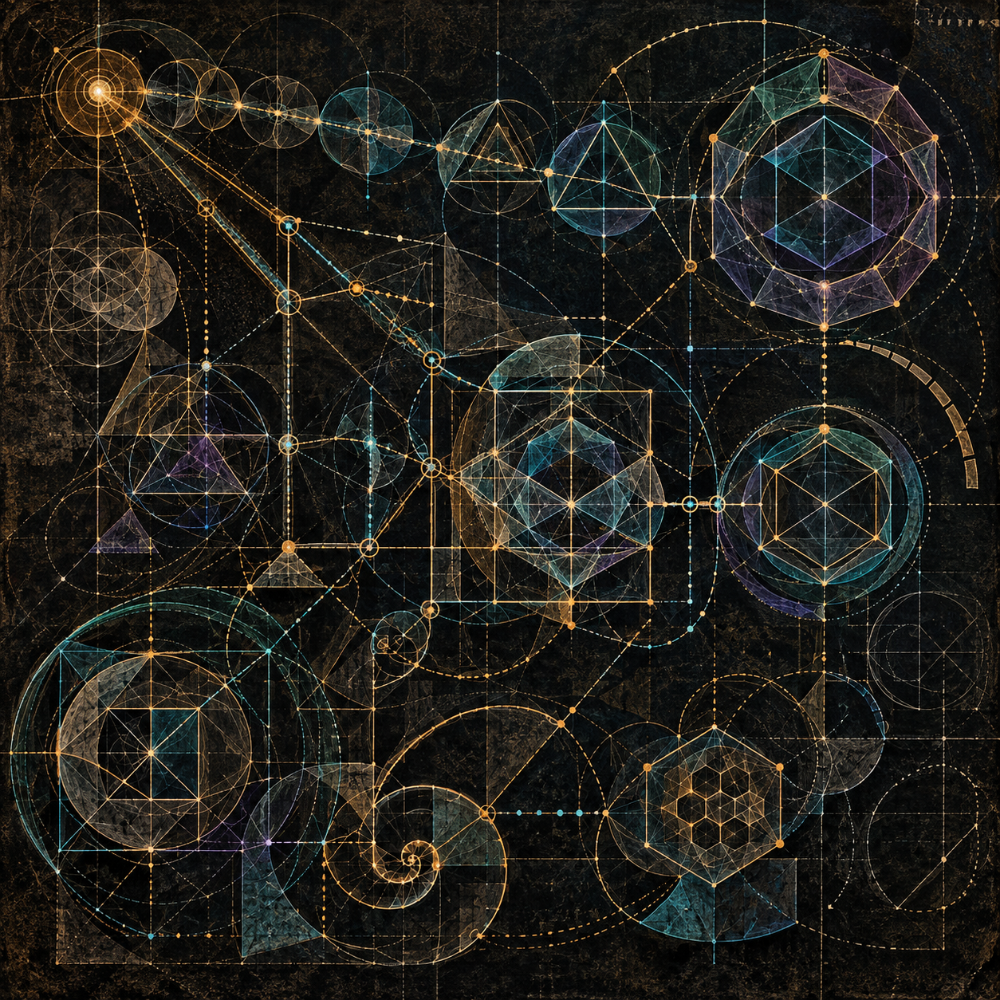
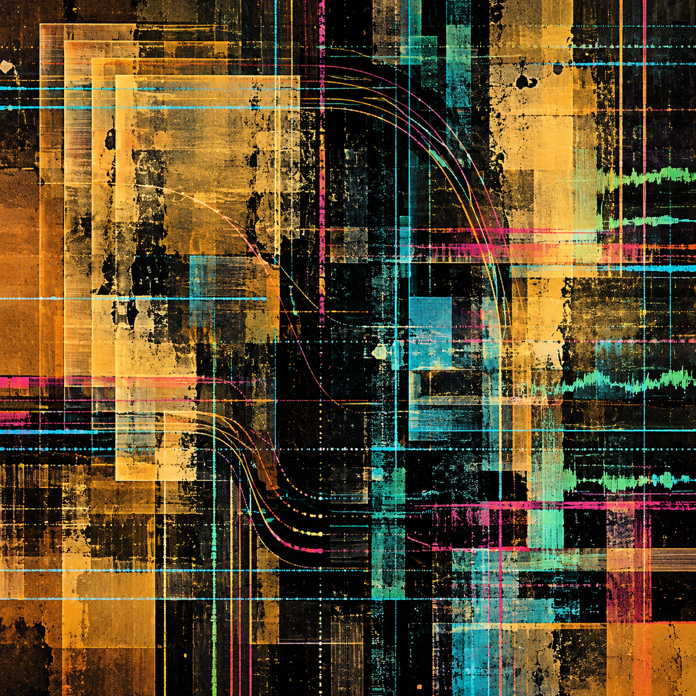

PERSONAL RESEARCH ETHICS · INTELLECTUAL METHODOLOGY · CONSENT

<h1>Ethical &amp; Intellectual Theory</h1>

<strong>The work may be examined. The person remains the authority on their consent.</strong>

A personal doctrine on intellectual work, conceptual debt, evidence, and the boundaries of constructing a model of another person.

<a href="research-ethics/SELF_DOCTRINE_EXTENDED.md"><strong>Read the full doctrine →</strong></a>
&nbsp; · &nbsp;
<a href="research-ethics/SELF_DOCTRINE_EXTENDED.md#xviii-consolidated-axioms">Explore the 14 axioms</a>
&nbsp; · &nbsp;
<a href="acap/README.md">AI collaboration protocol</a>
&nbsp; · &nbsp;
<a href="#document-history">Document history</a>

19 sections &nbsp; / &nbsp; 14 consolidated axioms &nbsp; / &nbsp; Sources preserved

---

## Reader's guide

This README is a **navigation and scope document**, not a certification of every linked research artifact. Begin with the doctrine, then use the subject-specific paths below.

| Reading path | Start |
| --- | --- |
| Foundational ethics and consent | [Full doctrine](research-ethics/SELF_DOCTRINE_EXTENDED.md) · [Consolidated axioms](research-ethics/SELF_DOCTRINE_EXTENDED.md#xviii-consolidated-axioms) |
| AI collaboration and technical methodology | [ACAP](acap/README.md) · [Programming doctrine](programming-doctrine/HUMAN_DOCTRINE.md) |
| Public outreach and research status | [ReShade guidance](outreach/reshade/README.md) · [Site-hydration and machine-EOL roadmap](research-ethics/EOL_SITE_HYDRATION_AND_REHYDRATION_ROADMAP.md) |
| Personal dossier and creative work | [Dossier](personal-dossier/personal_reconstruction_anonymized.md) · [Musings](personal-dossier/musings/README.md) |
| Provenance, limits, and corrections | [Fallibility and redress](research-ethics/FALLIBILITY_APPROXIMATION_AND_REDRESS.md) · [Errata](ERRATA.md) · [Document history](#document-history) |

The public-facing **Stage 0** site-hydration effort is **asymmetric and ongoing**, with a temporary pause anticipated for ancillary-site retooling. **Each project has its own stages**; the roadmap is not a global stage sequence. Private information is outside the public release boundary.

## Scope Notice — A Bounded View of a Greater Ethical Theory

This doctrine presents a scoped view of a greater theory of ethics. It applies that larger ethical framework to intellectual methodology, derivation, attribution, personal modeling, consent, artificial-intelligence adaptation, and archival integrity.

It is not intended to state the whole theory from which it proceeds. Its definitions, distinctions, and prohibitions are developed for the particular domain addressed here. They should not be mistaken for an exhaustive account of ethics, personhood, responsibility, knowledge, relationship, authority, or harm.

Principles expressed in this doctrine may participate in a broader ethical structure, but this document establishes only the bounded position stated within its own scope. No unstated portion of the greater theory should be inferred, reconstructed, or attributed to the individual solely from this application.

---

> **“Access is not consent.”**
>
> The availability of a work does not establish permission for every inference, profile, retention, or use that the work makes technically possible.
>
> — [Axiom 1, Self-Doctrine](research-ethics/SELF_DOCTRINE_EXTENDED.md#axiom-1-access-is-not-consent)

## Foundational doctrine and interpretation

The foundational documents, distinctions, and reading questions are grouped here so the scope and evidentiary limits can be assessed before applied work.

### Begin with the doctrine

Intellectual work can be studied, tested, discussed, and learned from. This doctrine examines the additional ethical questions that arise when analysis turns toward the person behind the work: their characteristic methods, inferred identity, or a retained model used to predict, imitate, authenticate, or influence.

**Explicit, specifically scoped consent is the governing condition.** Permission applies to the activity approved. Material expansion requires renewed consent.

| Read | What you will find |
| :--- | :--- |
| **[Full nineteen-section doctrine](research-ethics/SELF_DOCTRINE_EXTENDED.md)** | The supplied extended statement, including provenance, evidence, AI adaptation, consent records, and correction. |
| **[Fourteen consolidated axioms](research-ethics/SELF_DOCTRINE_EXTENDED.md#xviii-consolidated-axioms)** | A concise entry point into the doctrine’s principal distinctions. |
| **[Final statement](research-ethics/SELF_DOCTRINE_EXTENDED.md#xix-final-statement)** | The concluding account of intellectual inquiry, personal modeling, and the limits of permission. |
| **[Fallibility, approximation, and redress](research-ethics/FALLIBILITY_APPROXIMATION_AND_REDRESS.md)** | A companion statement on coincidental resemblance, excluded sources, ethical recognition, contaminant ejection, and voluntary mediation. |

### The distinctions that matter

| Principle | Its consequence within the doctrine |
| :--- | :--- |
| **[Access is not consent](research-ethics/SELF_DOCTRINE_EXTENDED.md#axiom-1-access-is-not-consent)** | Availability alone does not authorize profiling, retention, or reuse. |
| **[Observation is not identity](research-ethics/SELF_DOCTRINE_EXTENDED.md#axiom-2-observation-is-not-identity)** | A characteristic found in a work does not independently establish a stable or unique account of its creator. |
| **[Attribution is not consent](research-ethics/SELF_DOCTRINE_EXTENDED.md#axiom-8-attribution-is-not-consent)** | Giving credit does not supply permission for a separate activity. |
| **[Preservation is not authority](research-ethics/SELF_DOCTRINE_EXTENDED.md#axiom-7-preservation-is-not-authority)** | An intact record may still be inaccurate, unauthorized, or misunderstood. |
| **[Uncertainty is a valid result](research-ethics/SELF_DOCTRINE_EXTENDED.md#axiom-11-uncertainty-is-a-valid-result)** | An unresolved claim should remain visibly unresolved when the evidence is insufficient. |
| **[A personal model does not supersede the person](research-ethics/SELF_DOCTRINE_EXTENDED.md#axiom-12-a-personal-model-does-not-supersede-the-person)** | A retained profile does not acquire authority over the individual’s present intent. |

### Follow a question

#### What changes when analysis turns from a work to its creator?

Read the [foundational principle](research-ethics/SELF_DOCTRINE_EXTENDED.md#i-foundational-principle), the [progressive boundary violations](research-ethics/SELF_DOCTRINE_EXTENDED.md#ii-progressive-boundary-violation), and the [permissible research boundary](research-ethics/SELF_DOCTRINE_EXTENDED.md#v-permissible-research-boundary).

These sections distinguish ordinary inquiry from deliberate personal profiling, persistent archival, and operational use.

#### What does the evidence actually establish?

Read [epistemic classes and claim discipline](research-ethics/SELF_DOCTRINE_EXTENDED.md#viii-epistemic-classes-and-claim-discipline), [fingerprints and evidential limits](research-ethics/SELF_DOCTRINE_EXTENDED.md#ix-declared-fingerprints-and-evidential-limits), and [implementation versus attestation](research-ethics/SELF_DOCTRINE_EXTENDED.md#xiii-implementation-is-not-attestation).

Declarations, observations, inferences, corroboration, and attestation retain different evidential roles.

#### How should influence, similarity, and disagreement be represented?

Read [style and false attribution](research-ethics/SELF_DOCTRINE_EXTENDED.md#x-style-imitation-and-false-attribution), [contradiction and transparent reconciliation](research-ethics/SELF_DOCTRINE_EXTENDED.md#xi-contradiction-variants-and-transparent-reconciliation), and [uncertain conceptual debt](research-ethics/SELF_DOCTRINE_EXTENDED.md#xii-derivation-incubation-and-uncertain-conceptual-debt).

Similarity does not independently establish authorship. Conceptual dependence deserves honest attribution, and uncertainty should remain visible.

#### What may an adaptive assistant retain or do?

Read [AI adaptation and personal modeling](research-ethics/SELF_DOCTRINE_EXTENDED.md#xiv-artificial-intelligence-adaptation-alignment-and-personal-modeling) and [consent as a versioned and bounded record](research-ethics/SELF_DOCTRINE_EXTENDED.md#xv-consent-as-a-versioned-and-bounded-record).

Immediate accommodation, retained preferences, methodological modeling, prediction, imitation, and delegation require distinct consideration.

#### What happens when consent or understanding changes?

Read [archival prohibition and consent](research-ethics/SELF_DOCTRINE_EXTENDED.md#vi-archival-prohibition-and-consent), [revocation and derived material](research-ethics/SELF_DOCTRINE_EXTENDED.md#xvi-revocation-correction-and-derived-material), and [personal attribution and anti-aggrandizement](research-ethics/SELF_DOCTRINE_EXTENDED.md#xvii-personal-attribution-and-anti-aggrandizement).

Correction, withdrawal, deletion limits, and the right to reject an interpretation belong within the account.

## AI collaboration, programming, and architectural methods

Applied methodology is separated from the doctrine itself. Proposed designs do not acquire implementation status through inclusion on this page.

### AI collaboration and attribution

The **AI Collaboration Attribution Protocol (ACAP)** applies the repository's concern with attribution and evidence by documenting how a human author and an AI collaborator worked together. It gives the human author a place to declare intent and editorial decisions, and the AI collaborator a place to report what it generated or transformed. The registries connect candidate material to what the author actually chose to incorporate.

**Human-directed decomposition and AI derivation under human instruction.** For this README's restructuring, the human operator supplies the decomposition, intended distinctions, and instructions. The AI derives and assembles the resulting organization, navigation, and editorial formulation in response to those instructions. The AI's contribution is a *derivative, instructed transformation*, not independent authorship of the underlying theory, not an autonomous source of authority, and not independent verification. This attribution applies to the README editorial work; provenance and authorship of each linked primary document remain governed by that document's own record.

- **[ACAP overview](acap/README.md)** — Choose where to begin and see how a draft becomes a recorded adoption.
- **[Fillable protocol](acap/protocol.md)** — Record both accounts and link contributions to adoption decisions.
- **[AI entry point](acap/ai-entry-point.md)** — Copy the prompt for the AI collaborator's own report.

### Programming doctrine

A bounded programming methodology connecting purpose, meaning, decomposition, explicit contracts, construction, code, and evidence. Human-authored theory and human-composed decomposition remain distinct from AI-assisted formulation, mappings, automation, and finite checks.

- **[Read the programming doctrine](programming-doctrine/HUMAN_DOCTRINE.md)**
- **[Open the machine-readable doctrine](programming-doctrine/DOCTRINE.json)**
- **[Publication scope and validation](programming-doctrine/PUBLICATION_AND_VALIDATION.md)**

The edition preserves explicit project profiles and open decisions. Its anonymous presentation does not imply personal identity, universal policy adoption, or runtime authority.

### Witness-failure terminology

[Read the four-part witness-failure terminology](legal-theory/witness-failure-terminology/README.md) — **Murdered Witness, Dead Witness, Undead Witness, and Suicide**. Controlled diagnostic categories for failures in legal reasoning and inherited justification, not established legal doctrines or findings of crime.

## Public outreach and ongoing research

The public-facing work and the machine-EOL case are distinct from the doctrine's primary ethical claims. Project-specific stages and reported observations retain their own evidence boundaries.

### ReShade research outreach — Before You Use AI

**[Read the published ReShade guidance](outreach/reshade/README.md)** · [Non-AI alternatives](outreach/reshade/ALTERNATIVES.md) · [Participation and consent](outreach/reshade/PARTICIPATION.md) · [Standalone HTML](outreach/reshade/index.html)

A public, personal proposal on when **not** to use AI, how to prefer human-led and deterministic shader research, why provenance matters, and how to offer voluntary criticism without extracting another person's intellectual identity. This is not an official ReShade statement. The depth-oracle case study remains **deferred pending external chat verification**; no private correspondence or third-party shader source has been published in the outreach section.

Prior drafts and their evolving intent remain preserved on the [research staging branch](https://github.com/alia-june/ethical-and-intellectual-theory/tree/staging/outreach-reshade/outreach).

### Current research phase — EOL simulation to site hydration

**Stage 0 milestone (operator-declared, 2026-11-12):** A specific `[REDACTED]` deployment segment has been marked concluded in an adversarial bot-harvest mitigation strategy described only as a passive defensive tactic `[REDACTED]`. This is **not** evidence of independently verified effectiveness or the end of ongoing public-facing Stage 0. [Read the restricted-detail public milestone record](research-ethics/STAGE_0_DEPLOYMENT_SEGMENT_CLOSURE_2026-11-12.md).

**Machine EOL clarification:** EOL means **machine end-of-life**, not personal end-of-life. Unexplained USB connect/disconnect sounds had preceded an earlier motherboard failure; when they recurred, they prompted this test. For the current incident the operator identified a **power-settings incompatibility**, not a repeat motherboard failure. The real warning was the impetus; the **infected-system scenario was simulated**. The hardware warning and the later AI interaction trigger are separate observations. The precise dates and independent diagnostic evidence are unresolved.

**Public-facing Stage 0 (asymmetric and ongoing):** hydrate and publish eligible public theory, specifications and qualified proofs of concept. The operator anticipates a **temporary pause for retooling ancillary sites**, not permanent completion; no pause date is set.

**Project-specific stages:** every project retains its own stage sequence; there is **no universal previous stage or common Stage 1**. A separate code-rehydration workstream proposes evidence-bound rules and expert systems first, with synthetic generative text only as a last resort. Private data remains outside the publication boundary.

**First EOL test condition:** the system was infected, making source code unsafe; triage was not possible, so the simulation required **ejecting working programs as clear text only**, with **no binary or binary representation**, not extracting source code. Working does not mean verified clean.

**Reported impediments:** Security System v1 and Health Monitoring System v3.

**Reported outcome:** **overall EOL simulation failure**, with a **protected time-critical preservation subtask completed before the deadline**, a **mixed mission-capture research result (succeeded and failed)**, and total system lockout for **two weeks**.

**Weak memory** is an operator-identified working limitation; pass/fail criteria and independent verification remain unresolved.

**AI behavior (operator report):** mission capture was studied from the outset; an episode was observed at the first report of symptoms and interpreted as complete role reversal, but the research result is mixed. Detection relied on ephemeral observation logging, introduced cognitive drift, and a sensitive contextual disclosure that the operator reports triggered the system; the disclosure content remains private and the internal trigger is unverified. Regular check-ins and external third-person monitoring were observed rather than AI-originated generic crisis-resource output in most or possibly all instances; this interpretation and attribution are not independently verified.

**Method — personal hydration:** the operator uses AI to build a **core memory gradually from small, cohesive layers of recollection**, with **GitHub as the default external memory constructor** for committed versions and visible corrections. AI organizes and proposes integration but does not independently attest the history; GitHub versions only committed records. Private memory contents are not published.

**Chronology:** the EOL-under-duress exercise was the **third code rehydration test** but the **first EOL simulation** (operator-reported; earlier test outcomes not attested here). [Read the phase history, status, and safeguards](research-ethics/EOL_SITE_HYDRATION_AND_REHYDRATION_ROADMAP.md).

## Personal dossier, visual work, and errata

The dossier, first-person companion, creative studies, and corrections are different evidence classes; they are not interchangeable.

### Personal dossier

A de-identified account of declared ethical positions and published programming methodology, with supporting sources, hypothetical boundary cases, and unresolved questions. The readable and structured editions distinguish declarations, published methodological positions, and editorial interpretations.

- **[Read the personal dossier](personal-dossier/personal_reconstruction_anonymized.md)**
- **[Open the machine-readable JSON](personal-dossier/personal_reconstruction_anonymized.json)**
- **[Reconstitution scope and validation](personal-dossier/RECONSTITUTION_AND_VALIDATION.md)**
- **[Michael Stuart — a short personal history](personal-dossier/MICHAEL_STUART_PERSONAL_HISTORY_CLEAR.md)** — an identified first-person account in a clear public form.
- **[Musings](personal-dossier/musings/README.md)** — creative construction studies and an illustrated poetry collection, presented as creative work rather than biographical proof, clinical evidence, or independent attestation.

The personal history is an identified first-person companion. It is distinct from the de-identified reconstruction and does not independently verify the reconstruction’s claims.

De-identification removes direct identifiers but does not guarantee that the combination of ideas is unrecognizable.

#### Visual abstractions

These images are abstract visual companions to the dossier. They interpret aspects of the work without representing identity, proving authorship, or independently attesting to any personal claim.

*Integrity Lattice — a sacred-geometric abstraction of provenance, verification, retained variants, bounded transformation, and information integrity.*

*Information Assurance — a nonfigurative abstraction of layered records, traceable transformation, redundancy, visible damage, and guarded information flow.*

#### Construction studies

- **[Proper Composition](personal-dossier/musings/proper-composition/README.md)** — Floral panels show how peg placement, inversion, and recurring forms shape a composition. The green panel makes the stopping point visible.
- **[Transmigration in a Bounded Space](personal-dossier/musings/transmigration-in-a-bounded-space/README.md)** — Compare the stock build, stock parts on a MyBuild frame, and Humucus in Hiding. A separate 2×2×1 build shows what a small core can support.
- **[Expanded MyBuild Frame Studies](personal-dossier/musings/expanded-mybuild-frame-studies/README.md)** — Three articulated builds explore silhouette, repeated joints, and ornament.

### Errata

**[Record 02 — Three regretted experiences and a change in priority](ERRATA.md#record-02)** records self-reported experiences, retrospective judgments, and a consent-priority lesson. Perceived intent and unresolved validation remain qualified.

## Provenance and document history

Read these sections for interpretive limitations and the preservation of earlier source versions.

### Provenance and interpretive status

This repository contains a personal research-ethics doctrine. Personal declarations are represented as declarations; their inclusion does not establish independent verification of cognition, identity, uniqueness, or scientific validity.

The extended statement describes the assistant’s contribution as editorial and structural. Assistant interpretations do not independently establish the individual’s position. The [full provenance statement](research-ethics/SELF_DOCTRINE_EXTENDED.md#provenance-and-interpretive-status) governs how that document should be read.

Ethical obligation, legal enforceability, scientific validity, and technical feasibility remain separate questions. The documents intentionally disclose no procedures for producing methodological fingerprints.

### Document history

<strong>Explore the original statement and its subsequent development</strong>

 

| Document | Place in the record |
| :--- | :--- |
| [Original Self-Doctrine](research-ethics/SELF_DOCTRINE_ORIGINAL.md) | The original supplied statement, preserved unchanged. |
| [Seven-section expansion](research-ethics/SELF_DOCTRINE_EXPANDED.md) | The earlier expansion, incorporating the clarification that explicit, specifically scoped consent may permit profiling and archival. |
| [Nineteen-section extended doctrine](research-ethics/SELF_DOCTRINE_EXTENDED.md) | The subsequently supplied statement, preserved unchanged, with expanded treatment of evidence, derivation, AI adaptation, consent, and correction. |

The original and earlier expansion remain available as source history. The extended doctrine is the primary reading entry on this page. Preservation of a document does not independently establish the truth or authority of its claims.

---

<strong>Study with care. Attribute honestly. Obtain consent.</strong>

A personal research-ethics doctrine.

