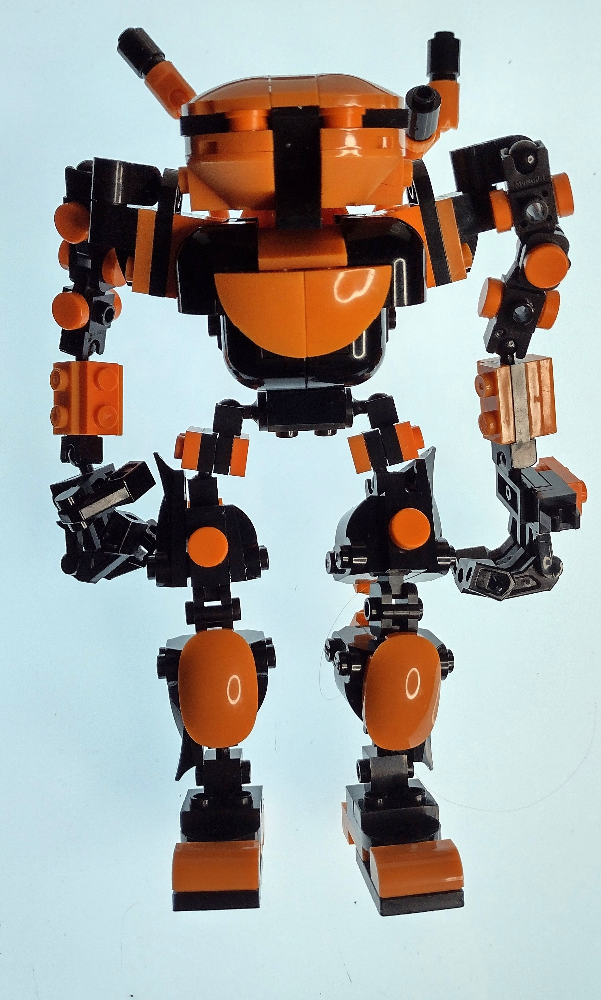
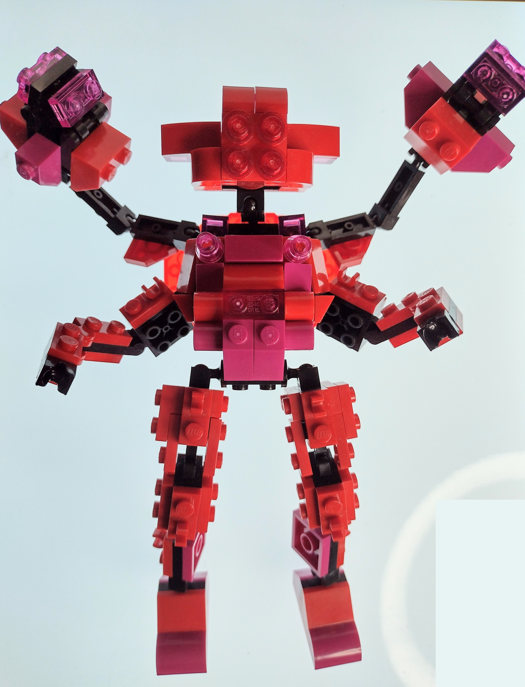
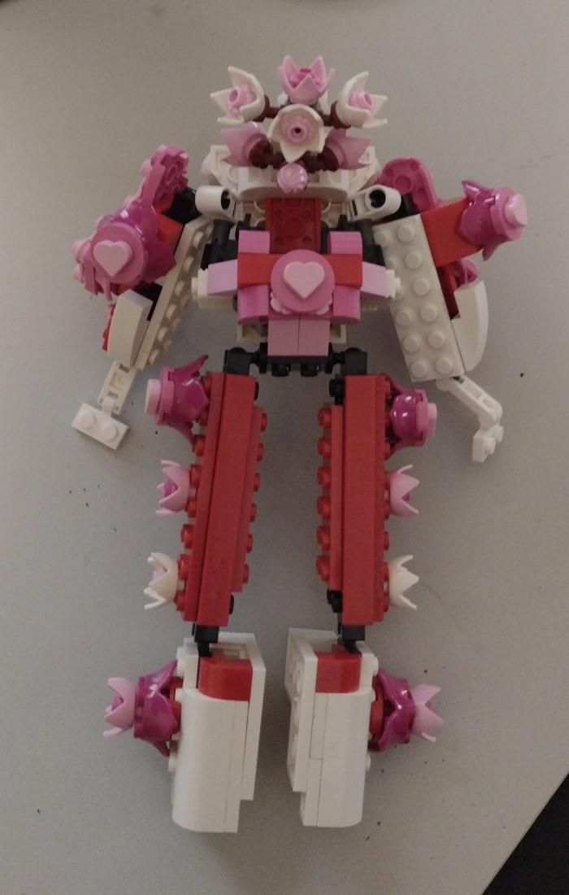

# Expanded MyBuild Frame Studies

These anonymized photographs present three informal studies using the expanded myBuild Frame: a modular figure-building structure developed through articulation, repeated joints, layered body shells, extended limbs, ornament, and character-specific variation.

“Expanded” refers to development beyond the underlying frame through added mass, armor, limbs, decorative systems, or specialized silhouette. The term identifies a construction approach within this collection; it does not designate an official LEGO system or independently establish authorship, chronology, ownership, or originality.

The photographs are included as creative musings rather than biographical evidence. They do not independently establish identity or the truth of any claim elsewhere in the dossier.

### Orange articulated build

A compact armored development of the myBuild Frame, emphasizing rounded exterior mass, visible joint transitions, asymmetrical detail, and a stable two-legged silhouette.

### Red multi-arm build

A multi-limb expansion of the myBuild Frame, using repeated articulation, radial gesture, concentrated color, and extension beyond the ordinary two-arm figure plan.

### Pink floral build

An ornamental development of the myBuild Frame, combining mechanical articulation and bilateral structure with repeated floral, heart, and armor motifs.

### Status

These images are anonymized publication derivatives. Their inclusion preserves a visual record of creative work while limiting disclosure of camera, time, device, and environmental context.

The photographs are not identity evidence or independent attestations of authorship.
