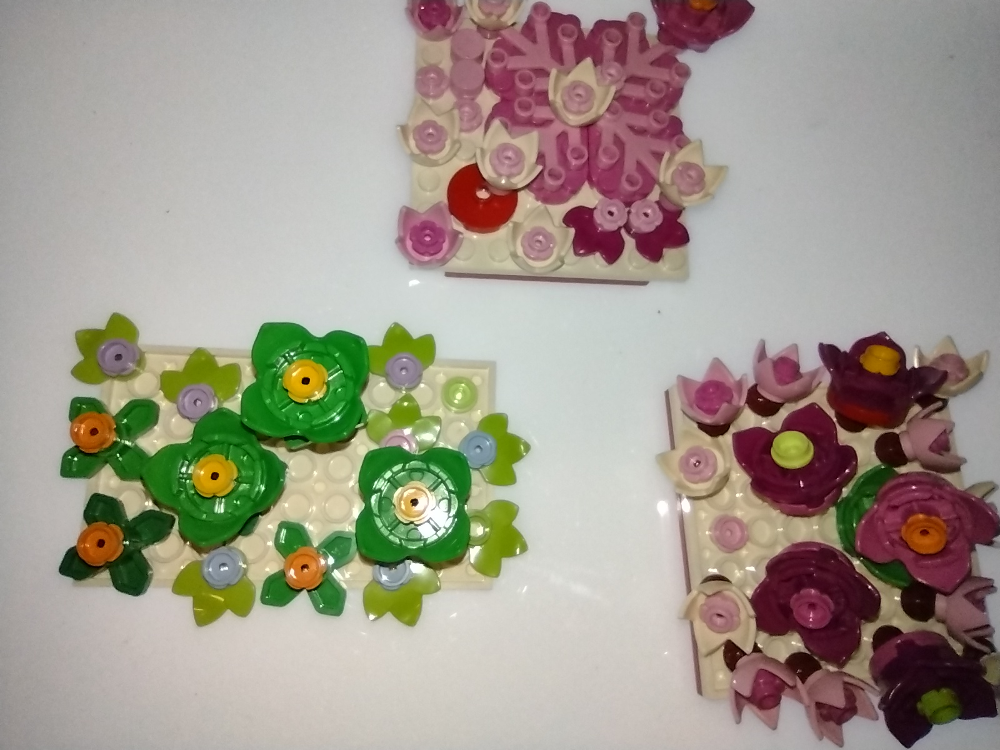
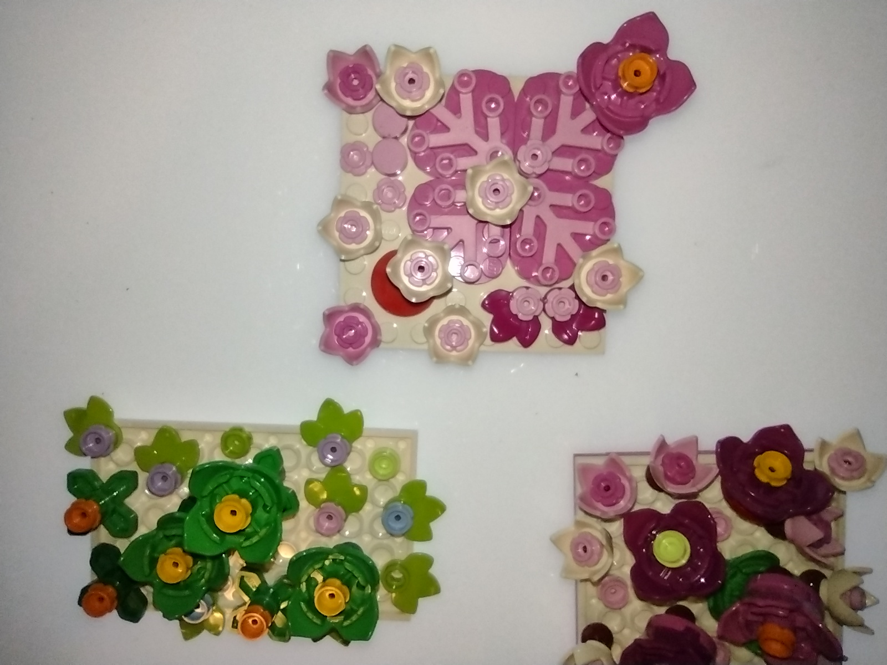
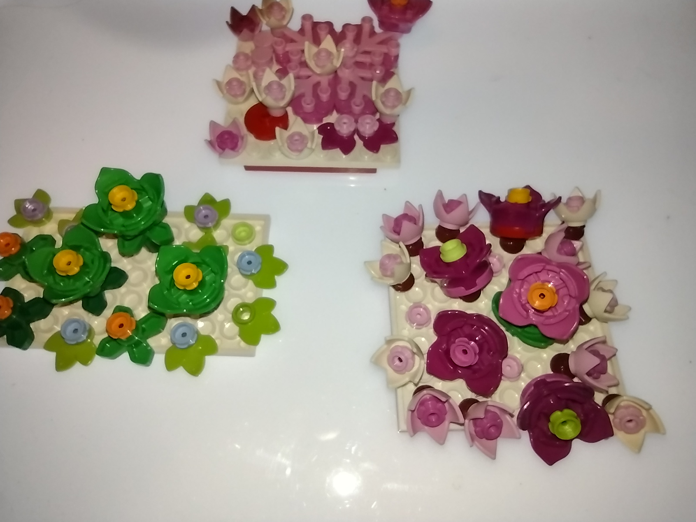

# Proper Composition

These three photographs show floral constructions made with LEGO pieces. The plates, pegs, flowers, stems, petals, and the spaces between them give us a way to see what makes an arrangement hold together and when it has reached its ending.

## Proper composition

Place the right pegs where they belong. A peg joins parts, and its position helps determine what those parts express together. A center and petals form a flower. That flower takes its place among other forms on a plate. The composition includes their relationships and the space they leave open.

## Proper reverse composition

Use the right pegs in an inverted arrangement that still expresses a proper construction. The inversion changes how the parts relate. The new arrangement must hold together and express a coherent whole on its own terms. The photographs show the visible arrangements. Some connections remain concealed by the assembled pieces.

## Recursion

The same structure is expressed in different forms. The flower recurs through stems or petals, with different colors, sizes, positions, and orientations. A flower is a composition in its own right and contributes to the larger composition of the panel. The recurring structure expresses completeness even when the individual flowers take different forms.

## Completeness and where to stop

The green panel shows a lack of completeness where the space is not fully used. At the level of the whole LEGO construction, that open space is the right stopping point. Less would make a different arrangement. More would be excess. This is composition in the classical sense. The parts and the space between them both shape the whole.

The densest arrangement begins to show what happens when building goes further. The parts crowd one another and the aesthetic begins to degrade. That is a good point for decomposting. Trimming removes excess from the existing arrangement. Decomposting takes what is worth carrying forward and builds a new arrangement. **Take what you like and rebuild.**

## Three views

