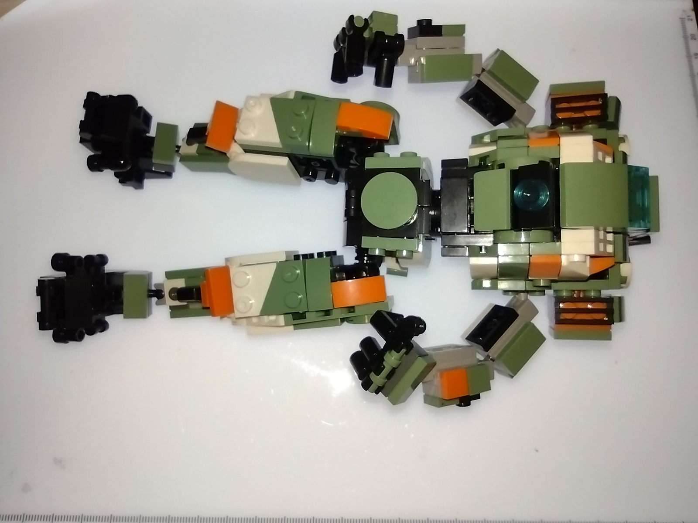
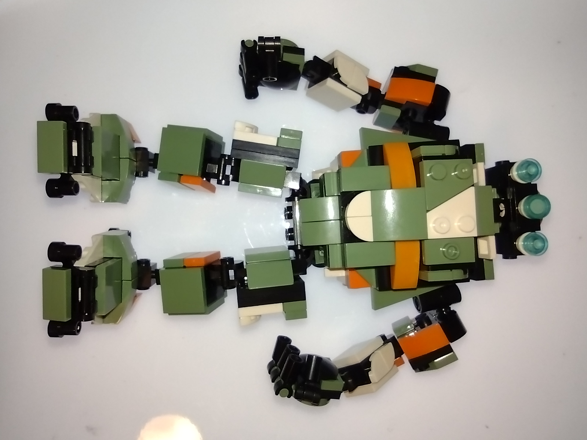
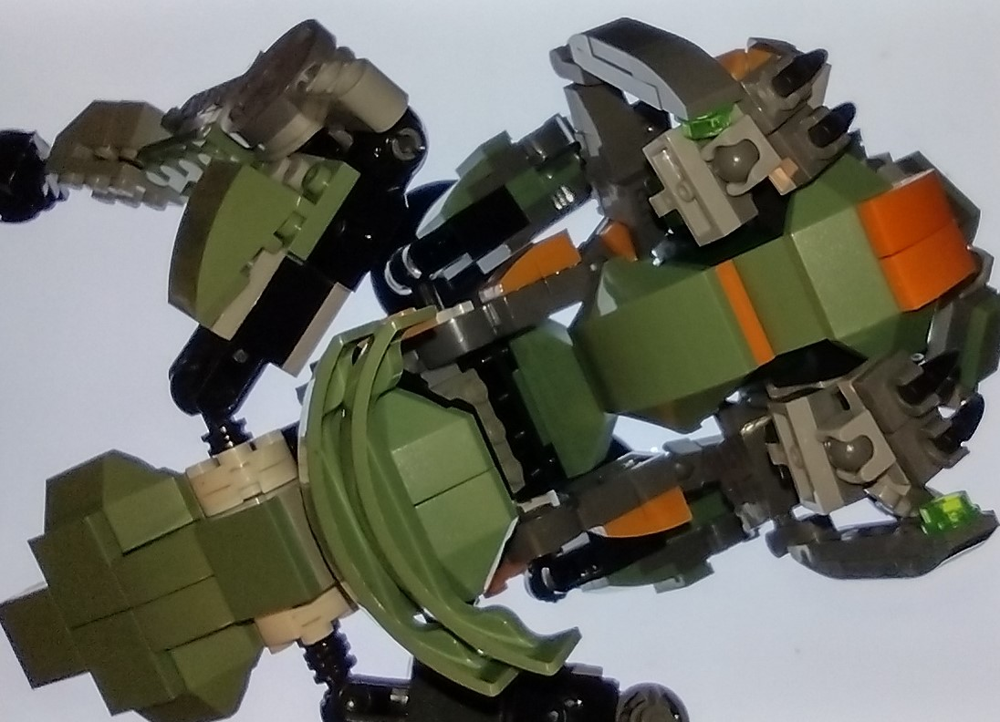
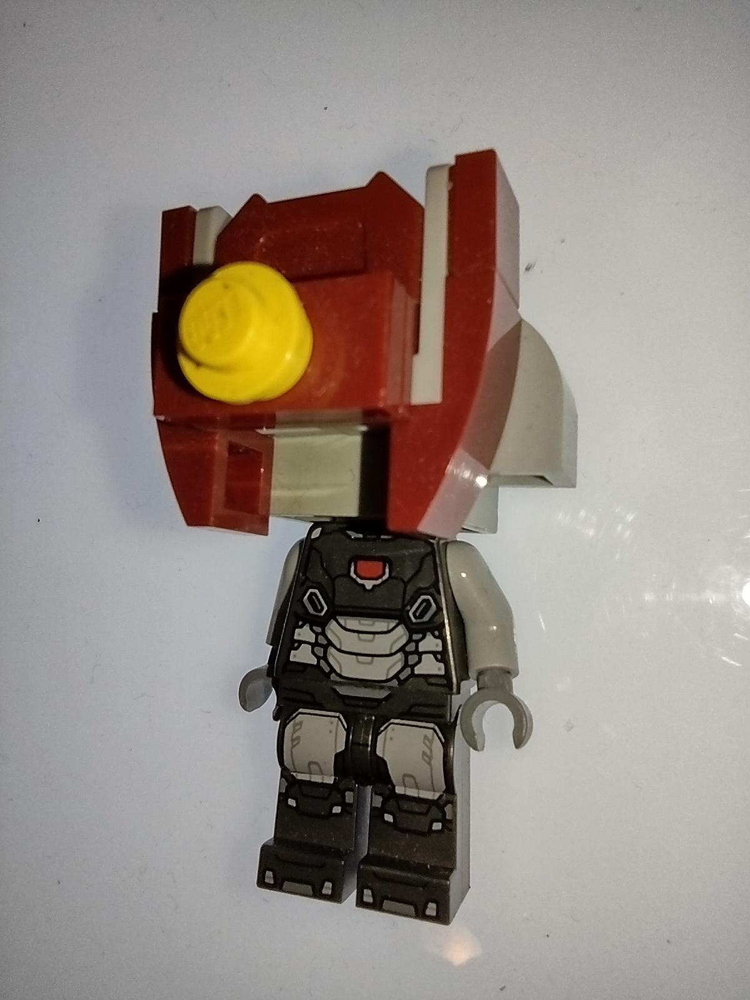

# Transmigration in a Bounded Space

> **Massive synthetic generative text error.** An earlier AI-generated draft turned visual resemblance into an explanation of transmigration, supplied an unsupported account of how the stock parts attach to the MyBuild frame, and placed the transmigration point under Image 2 as though that photograph established it. These were errors introduced by the AI draft. The corrected account treats green and orange as visible resemblance and records the author’s statement that a completely original build was the point of transmigration.
>
> [Repository errata](../../../ERRATA.md#massive-synthetic-generative-text-error).

## Part 1. The pieces have to interlock

Take the problem of being original in a strict space. LEGO and LEGO-like pieces have to interlock. The pieces are technically *infinitely finite*, and in practice they are limited and finite. Working with interlocking blocks of certain sizes is constricting.

In my micro-build universe, the **1×1 flat and the 1×2 flat are atomic**. With the ordinary pieces I am using, I cannot build sideways. The rare **1×1 with a side connector** changes that. It is a small piece that opens a new direction of attachment.

Add the **2×2, 2×3, 3×3, and 4×4 flats**, and I can build larger forms without losing the detail of a micro-build. A small number of purely cosmetic pieces can change what the structure expresses. The bounds are still there. The pieces still have to fit.

## Part 2. Humucus in Hiding

### Image 1. The stock build

[Stock-build listing supplied for comparison](https://www.ebay.com/itm/147606228686)

### Image 3. Stock parts on a MyBuild frame

### Image 2. Humucus in Hiding

### The point of transmigration

The original Humucus lacked understanding. A completely original build was the point of transmigration. The newer Humucus uses parts from entirely different sets. Green and orange are the visible resemblance to the other two builds. For better or for worse, he is Humucus. He carries a homunculus.

## Part 3. Micro-construction on a 2×2×1 solid block

This is a separate micro-construction. The **2×2×1 solid block** is the core of the head assembly. The pieces around it can extend beyond that core. The red sets the outline, the pale pieces interrupt it, and a single round yellow piece gives the face a focal point. On the minifigure body, those few choices are enough to give the figure a character of its own.
